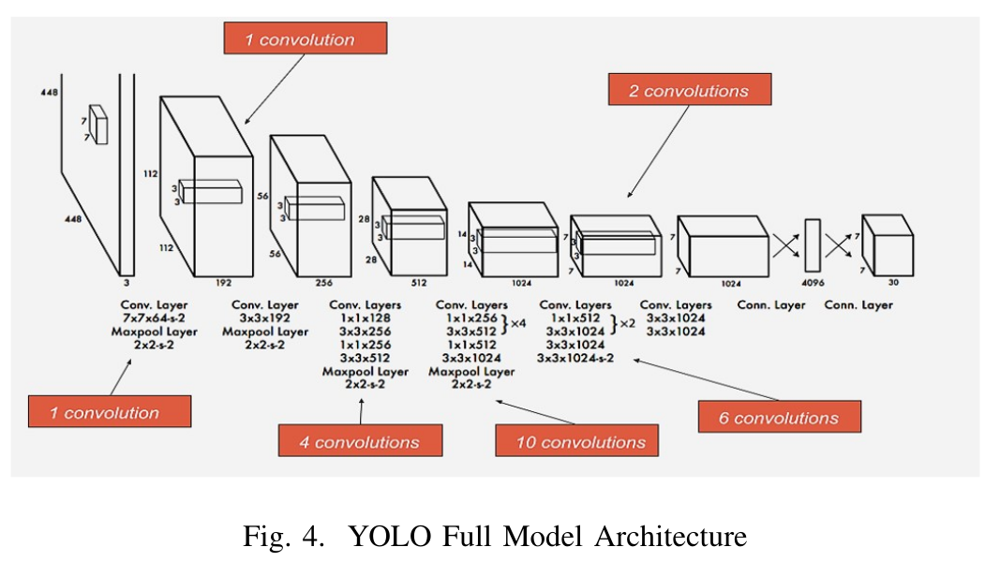
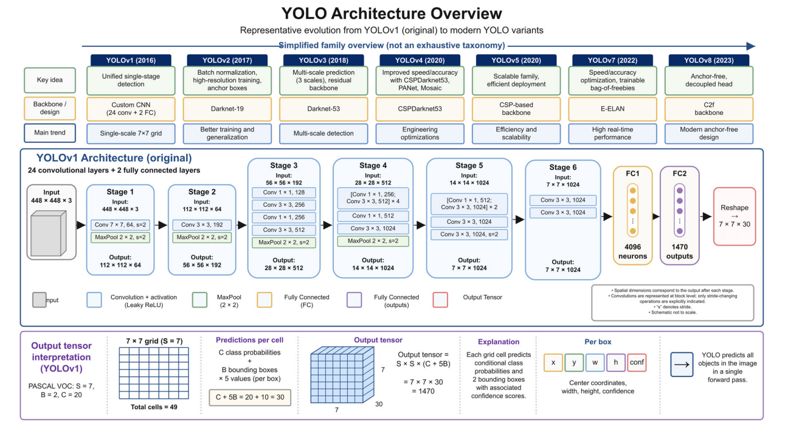

# YOLOv1 – architektura

## Hlavní myšlenka
YOLO (You Only Look Once) rozdělí obrázek na **mřížku S × S buněk** (v YOLOv1 7 × 7) a každá buňka funguje jako samostatný detektor. Buňky se ale nezpracovávají každá zvlášť – celý obrázek projde sítí **jen jednou** a výstupem jsou rovnou boxy i třídy pro všech 49 buněk.

Za objekt je zodpovědná **pouze ta buňka, do které padne střed objektu**.

## Co síť vrací
Výstupem je tenzor **[7, 7, 30]** – pro každou buňku vektor 30 hodnot:

| Hodnoty | Význam |
|---|---|
| 5 | Box 1: x, y, w, h, confidence |
| 5 | Box 2: x, y, w, h, confidence |
| 20 | pravděpodobnosti tříd (PASCAL VOC), společné pro oba boxy |

- **x, y** – střed boxu relativně vůči levému hornímu rohu buňky (0–1)
- **w, h** – šířka a výška relativně vůči celému obrázku (0–1)
- **confidence** – jak moc si je síť jistá, že v boxu je objekt, a jak dobře box sedí
- YOLOv1 **nemá třídu „pozadí“** – buňka bez objektu má nízkou confidence

## Struktura sítě

- **Vstup:** obrázek 448 × 448 × 3
- **Páteř:** 24 konvolučních vrstev (inspirace GoogLeNet), střídají se 3 × 3 konvoluce a 1 × 1 konvoluce pro snížení počtu kanálů
- **Výstup páteře:** příznaková mapa 7 × 7 × 1024
- **Hlava:** 2 plně propojené (FC) vrstvy – FC 4096 a FC 7 · 7 · 30 = 1470 hodnot, které se přeskládají (reshape) na [7, 7, 30]
- **Aktivace:** LeakyReLU (0.1) ve všech vrstvách kromě poslední, ta je lineární
- **Dropout** 0.5 za první FC vrstvou
- Prvních 20 konvolučních vrstev bylo předtrénováno na klasifikaci ImageNet (vstup 224 × 224), pro detekci se přidaly další vrstvy a vstup se zvětšil na 448 × 448

*Zdroj: González García, M., Noguera Polania, J. C., González Combarros, R., López Sánchez, J. I. „Automatic insect identification, counting, and monitoring techniques: a review.“ Pest Management Science, 2026, Figure 2*
