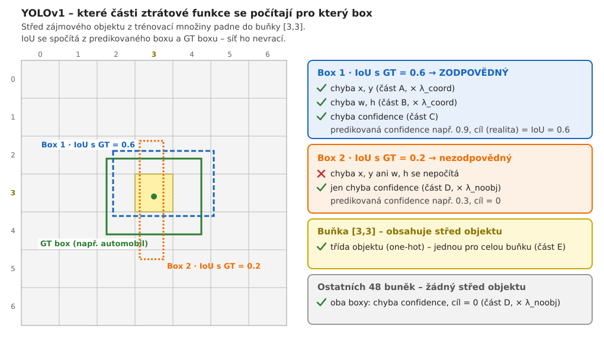

# YOLOv1 – trénování (target a ztrátová funkce)

> Vše popsané v tomto souboru se týká **trénování** – ztrátová funkce se počítá jen při učení, protože potřebuje ground truth (GT boxy a třídy).

## Jak z GT vznikne target

Ztrátová funkce porovnává výstup sítě `[7, 7, 30]` s **targetem** stejného tvaru, který se sestaví z anotací (GT boxů):

1. Najdeme buňku, do které padne **střed** GT boxu – ta je za objekt zodpovědná.
2. Do této buňky zapíšeme box (x, y vůči buňce; w, h vůči celému obrázku), na místo confidence 1 (je zde objekt) a třídu (one-hot).
3. Všechny ostatní buňky mají na místě confidence 0.

*Příklad:* střed zájmového objektu z trénovací množiny (třída *pes*) padne do buňky [3,3] → do targetu na pozici [3,3] zapíšeme jeho box, 1 a třídu *pes*.

Který ze dvou predikovaných boxů buňky bude zodpovědný, se rozhodne až během tréninku podle IoU – viz níže.

## Ztrátová funkce – které části se počítají pro který box

V buňce, kde je střed objektu, jsou dva predikované boxy (B = 2). Pro oba se spočítá IoU s GT boxem a zodpovědným se stane ten s vyšším IoU. Jen pro něj se počítá:
- chyba x, y (část A),
- chyba w, h (část B),
- chyba confidence s cílem IoU (část C).

> **Celkovým cílem je, aby IoU bylo co nejvyšší** – tedy aby predikovaný box co nejlépe seděl na GT box. O to se starají části **A a B**, které box posouvají a upravují jeho velikost.

Pro druhý box v téže buňce se chyba x, y, w, h nepočítá vůbec. Počítá se pro něj jen chyba confidence s cílem 0 (část D).

Ve vzorci ze článku to zajišťují indikátory s indexy **i** a **j**:
- **i** – index buňky (0 … S² − 1, tj. 0 … 48),
- **j** – index boxu v buňce (0 … B − 1, tj. 0 nebo 1).

Indikátor 𝟙ᵢⱼᵒᵇʲ je 1 jen tehdy, když buňka *i* obsahuje objekt a zároveň je box *j* v této buňce zodpovědný. Indikátor 𝟙ᵢᵒᵇʲ (jen s indexem buňky *i*, bez *j*) říká „buňka *i* obsahuje objekt“ a používá se jen u chyby třídy (část E), protože třídy jsou společné pro celou buňku.

## Příklad

Buňka [3,3] obsahuje střed zájmového objektu z trénovací množiny (třída *pes*).
- Box 1 má IoU s GT 0.6 a box 2 IoU 0.2.
- Box 1 je zodpovědný, proto se pro něj počítá chyba x, y, w, h a chyba confidence (cíl = IoU = 0.6).
- Pro box 2 se počítá jen chyba confidence (cíl = 0, část D).
- Třída „pes“ se trénuje jednou pro celou buňku.

## Přehled

Části ztrátové funkce YOLOv1:
- **A)** chyba x, y
- **B)** chyba w, h
- **C)** chyba confidence u boxů s objektem (cíl = IoU)
- **D)** chyba confidence u boxů bez objektu – noobj (cíl = 0)
- **E)** chyba třídy

## Chyba třídy (část E)

Ve článku vypadá poslední člen ztrátové funkce takto:

$$\sum_{i=0}^{S^2} \mathbb{1}_i^{obj} \sum_{c \in \text{classes}} \big(p_i(c) - \hat{p}_i(c)\big)^2$$

- **Vnější suma přes *i*** jde přes všechny buňky, ale díky **𝟙ᵢᵒᵇʲ** se počítá jen pro buňky, které obsahují střed objektu.
- **Index *j* tu chybí** – pravděpodobnosti tříd má celá buňka jen jednou a sdílí je oba boxy (posledních 20 hodnot ve vektoru 30). Nezáleží tedy na tom, který box je zodpovědný.
- **Vnitřní suma přes *c*** jde přes všech 20 tříd – rozdíl predikce a cíle se počítá u každé třídy.
- **Cíl** je one-hot: 1 u správné třídy, jinak 0.
- **Bez váhy λ** (resp. s váhou 1) a stejně jako u ostatních částí se používá SSE (součet čtverců).
**Příklad pro buňku [3,3] (pes):**
- Predikce: pes 0.7, kočka 0.2, auto 0.1, ostatní 0
- Cíl: pes 1, ostatní 0
- Chyba = (0.7 − 1)² + (0.2 − 0)² + (0.1 − 0)² = 0.09 + 0.04 + 0.01 = **0.14**

Ostatních 48 buněk do této části nepřispívá vůbec.

## Proč je u části D váha λ_noobj = 0.5

Většina buněk žádný objekt neobsahuje. V obrázku s jedním objektem je 7 × 7 × 2 = 98 boxů – zodpovědný je jen 1, pro zbylých 97 se počítá chyba confidence s cílem 0 (část D). Bez snížení váhy by tyto chyby převážily a síť by se naučila hlavně „všude je confidence 0“.

Proto spolupracují dvě váhy:
- **λ_noobj = 0.5** – sníží vliv boxů bez objektu na polovinu,
- **λ_coord = 5** – naopak zvýší vliv lokalizace (x, y, w, h) u zodpovědných boxů.
