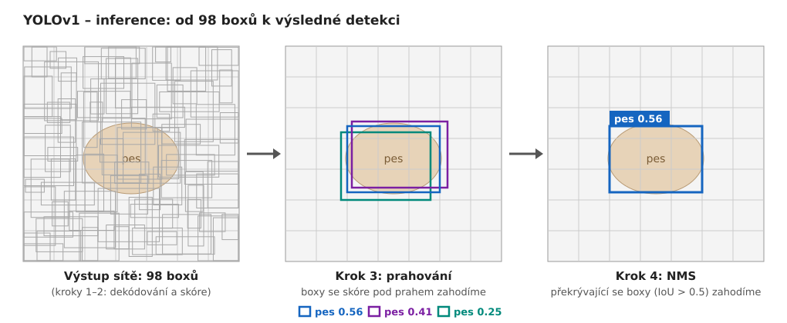

# YOLOv1 – inference (od výstupu sítě k výsledným boxům)

> Při inferenci už nemáme ground truth – nepočítá se ztrátová funkce, IoU s GT ani se nevybírá zodpovědný box. Síť vrátí výstup `[7, 7, 30]` a z něj vybereme výsledné detekce.

Výstup obsahuje celkem 7 × 7 × 2 = **98 boxů**. Výsledné detekce z nich dostaneme ve čtyřech krocích:

## 1. Dekódování souřadnic
1. Převést x, y z relativních souřadnic buňky na relativní souřadnice obrázku. U w, h není potřeba nic dělat, ty už relativní k obrázku jsou.
2. Pro vykreslení do obrázku (v pixelech) vynásobit všechny čtyři hodnoty rozměry obrázku (x a w šířkou, y a h výškou).

## 2. Skóre pro každou třídu
- Každý box má svou **confidence**: jestli v něm je nějaký objekt a jak dobře sedí (o třídě neříká nic). Síť se ji při tréninku naučila jako odhad IoU.
- Buňka má **pravděpodobnosti tříd**: *pokud* tu objekt je, o jakou třídu jde (sdílené oběma boxy).
- Jejich vynásobením dostaneme pro každý box a každou třídu jedno **skóre**:
  `skóre = confidence boxu × pravděpodobnost třídy`

*Příklad:* Buňka má pravděpodobnosti pes = 0.7, kočka = 0.2, …
- Box 1 má confidence 0.8 → skóre pes = 0.8 × 0.7 = **0.56**
- Box 2 má confidence 0.1 → skóre pes = 0.1 × 0.7 = **0.07** → v dalším kroku vypadne

Vysoké skóre tedy znamená, že box dobře sedí na objekt **a zároveň** si je síť jistá jeho třídou.

## 3. Prahování
- Boxy se skóre pod prahem (např. 0.2) zahodíme.
- V praxi se tento práh nastavuje jako parametr `conf` detektoru (např. v Ultralytics).
- Díky části D ztrátové funkce (cíl confidence = 0 u boxů bez objektu) mají prázdné buňky nízkou confidence, a proto zde samy vypadnou.

## 4. NMS (Non-Maximum Suppression)
- Jeden objekt často zachytí více boxů (např. ze sousedních buněk).
- Pro každou třídu zvlášť:
  1. Vezmeme box s nejvyšším skóre → ponecháme ho.
  2. Odstraníme všechny ostatní boxy, které ho překrývají s IoU > 0.5.
  3. Opakujeme se zbývajícími boxy.
- Pozor: IoU se zde počítá **mezi predikovanými boxy navzájem**, ne s GT (to při inferenci nemáme).
- V praxi se tento práh nastavuje jako parametr `iou` detektoru.
