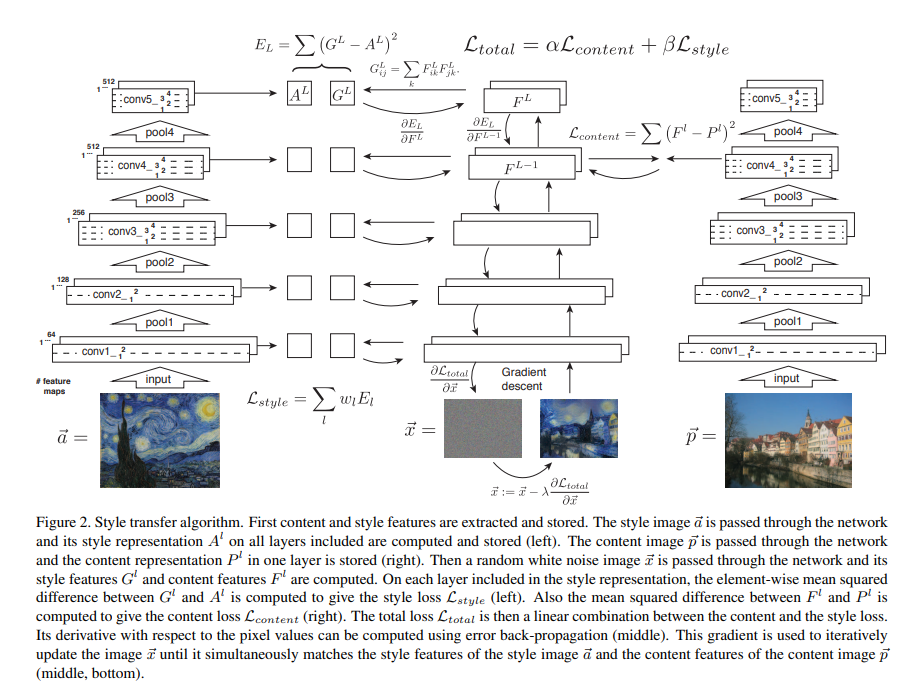
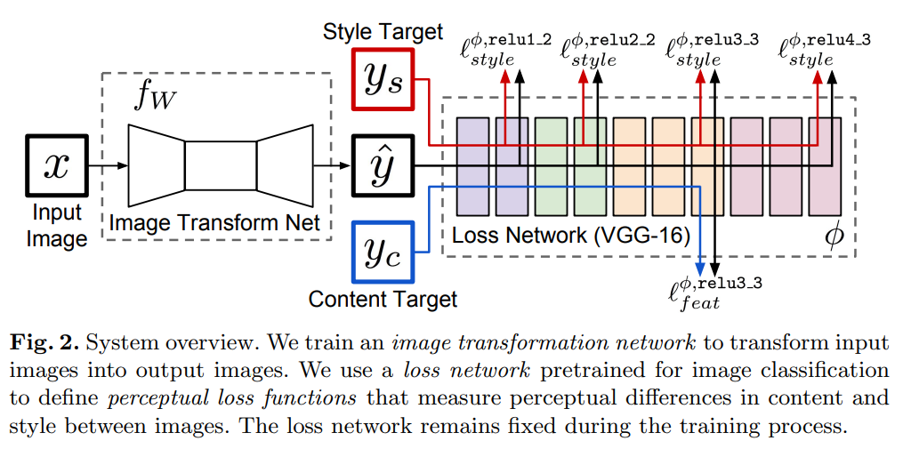
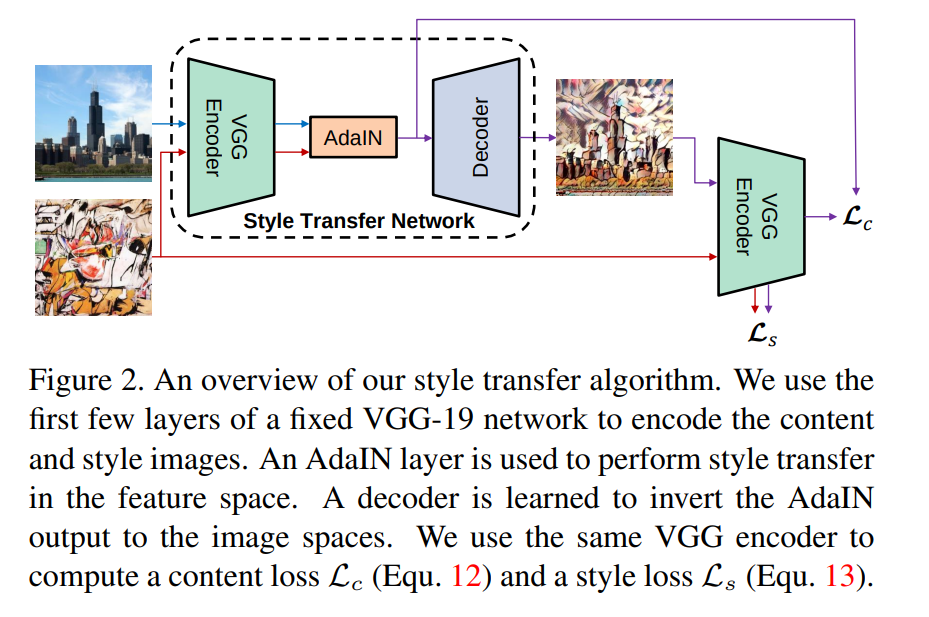
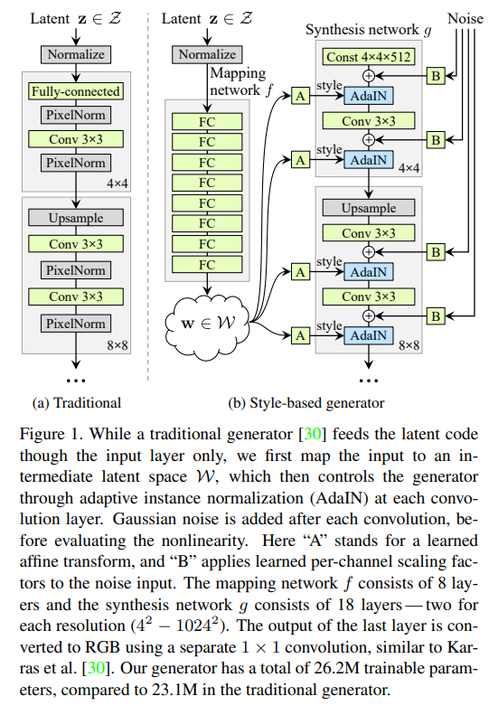

# Přenos stylu (Style Transfer) a StyleGAN

**(PRACOVNÍ VERZE v1)**

Navazuje na přednášku o generativních sítích (GAN) a ukazuje cestu od klasického přenosu uměleckého stylu až k řízení vzhledu generovaných obrazů v architektuře StyleGAN.

---

## Přehled vývoje

| Metoda | Rok | Hlavní princip | Omezení / posun | Publikace |
|---|---|---|---|---|
| **Gatys et al.** | 2015 | Styl je popsán Gramovou maticí (korelace filtrů). Pixely nového obrázku se hledají pomalou optimalizací. | Každý obrázek se počítá stovky kroků od nuly. | [arXiv:1508.06576](https://arxiv.org/abs/1508.06576) |
| **Fast Style Transfer** | 2016 | Místo hledání pixelů se natrénuje dopředná neuronová síť, která obrázek přebarví jedním průchodem. | Jedna natrénovaná síť umí pouze jeden konkrétní styl. | [arXiv:1603.08155](https://arxiv.org/abs/1603.08155) |
| **Styl pomocí $\mu$ a $\sigma$** | 2017 | Ukázalo se, že místo celé Gramovy matice stačí pro každý filtr jen průměr ($\mu$) a směrodatná odchylka ($\sigma$). | Stále jde o pomalou optimalizaci, ale definice stylu je výrazně jednodušší. | [arXiv:1701.01036](https://arxiv.org/abs/1701.01036) |
| **AdaIN** | 2017 | Příznaky obsahu se normalizují a rovnou se jim nastaví průměr a odchylka ze stylového obrázku. | Jedna síť zvládne libovolný styl v reálném čase. | [arXiv:1703.06868](https://arxiv.org/abs/1703.06868) |
| **StyleGAN** | 2019 | Generátor v GANu používá AdaIN v každé vrstvě. Průměry a odchylky si nebere z malby, ale počítá je z latentního vektoru. | Umožňuje nezávisle řídit hrubé tvary, detaily i barevné ladění generovaného obrazu. | [arXiv:1812.04948](https://arxiv.org/abs/1812.04948) |

---

## 1. Klasický Neural Style Transfer
*Gatys, Ecker, Bethge, 2015 – „A Neural Algorithm of Artistic Style“ ([arXiv:1508.06576](https://arxiv.org/abs/1508.06576))*

**Princip:**
1. Předtrénovaná síť VGG-19 slouží jako pevný extraktor příznaků (její váhy jsou zmrazené a během výpočtu se nemění). V každé vrstvě vytváří **mapy příznaků** (*feature maps*) tvaru $(C, H, W)$, kde $C$ je počet filtrů (kanálů) a $H \times W$ jsou prostorové rozměry.
2. Sítí se pošlou tři obrázky: **obsahový** ($p$), **stylový** ($a$) a **generovaný** ($x$, na začátku kopie obsahu nebo šum).
3. **Obsahová ztráta ($L_{\text{content}}$):** ve vybrané vyšší vrstvě se porovnávají mapy příznaků generovaného a obsahového obrázku filtr po filtru a místo po místu pomocí kvadratické chyby (MSE). Tím se zachovají tvary a umístění objektů.
4. **Stylová ztráta ($L_{\text{style}}$):** v několika vrstvách se pro každý obrázek spočítá **Gramova matice** velikosti $C \times C$. Ta pro každou dvojici filtrů udává, jak často se v obraze aktivují společně (prostorová informace $H \times W$ se zprůměrováním zahodí). Ztráta je pak MSE mezi Gramovými maticemi generovaného a stylového obrázku.
5. Pomocí gradientního sestupu se přímo **upravují pixely obrázku $x$**, aby součet obou ztrát byl co nejmenší.

**Slabina:** Vytvoření jediného obrázku vyžaduje stovky průchodů sítí VGG (optimalizace trvá sekundy až minuty).

---

## 2. Fast Style Transfer – přenos stylu dopřednou sítí
*Johnson, Alahi, Fei-Fei, 2016 – „Perceptual Losses for Real-Time Style Transfer and Super-Resolution“ ([arXiv:1603.08155](https://arxiv.org/abs/1603.08155))*

**Problém:** Optimalizovat pixely pro každou novou fotografii od začátku je příliš pomalé pro praktické nasazení nebo video.

**Řešení:**
1. Předem se natrénuje samostatná **transformační síť** (typu encoder-decoder s reziduálními bloky), která na vstupu přijme fotografii a na výstupu vrátí přebarvený obraz.
2. Zmrazená předtrénovaná síť VGG (např. VGG-16 nebo VGG-19) se použije **pouze během tréninku** pro výpočet obsahové a stylové ztráty (tzv. *perceptual loss*).
3. Místo jednoho obrázku se optimalizují **váhy transformační sítě** na tisících fotografiích pro jeden vybraný stylový obraz.
4. Po natrénování se VGG zahodí. Nová fotografie se stylizuje **jediným dopředným průchodem** (*forward pass*) za několik milisekund.

**Slabina:** Styl je pevně zakódován do vah transformační sítě. Pro každý další umělecký styl je nutné natrénovat a uložit novou síť.

---

## 3. Styl jako průměr a směrodatná odchylka
*Li, Wang, Liu, Hou, 2017 – „Demystifying Neural Style Transfer“ ([arXiv:1701.01036](https://arxiv.org/abs/1701.01036))*

**Myšlenka:** Gramova matice počítá vztahy mezi všemi dvojicemi filtrů (např. ~100 000 čísel napříč vrstvami VGG). Ukázalo se však, že většina těchto informací není pro zachycení stylu nutná. Stačí pro každý filtr spočítat pouze dvě hodnoty přes plochu jednoho obrazu ($H \times W$):
1. **Průměr ($\mu$):** jak silně je daný filtr v obraze celkově zastoupen.
2. **Směrodatnou odchylku ($\sigma$):** jak moc se aktivita filtru v různých částech obrazu mění (zda je vlastnost rozprostřená rovnoměrně, nebo jen lokálně).

**Souvislost s Gramovou maticí:**
V Gramově matici leží mimo diagonálu vztahy mezi různými filtry („které dva filtry svítí společně“), zatímco na diagonále je každý filtr porovnán sám se sebou („jak moc filtr v obraze celkově svítí“). Použití průměru $\mu$ a odchylky $\sigma$ tedy zhruba odpovídá zachování **pouze diagonály Gramovy matice**. Vztahy mezi různými filtry se zahodí, a výsledný obraz přesto vypadá téměř stejně jako u původní metody.

**Poznámka k názvu v článku:**
V publikaci se metoda nazývá *BN statistics matching* (podle vrstvy Batch Normalization, která počítá průměr a odchylku). Protože se ale statistiky počítají vždy pro jeden konkrétní obrázek zvlášť a ne přes celou dávku, odpovídá tento výpočet vrstvě **Instance Normalization (IN)**.

---

## 4. AdaIN – Adaptive Instance Normalization
*Huang, Belongie, 2017 – „Arbitrary Style Transfer in Real-Time with Adaptive Instance Normalization“ ([arXiv:1703.06868](https://arxiv.org/abs/1703.06868))*

**Spojení předchozích poznatků:**
Pokud je styl definován pouze průměrem ($\mu$) a směrodatnou odchylkou ($\sigma$) jednotlivých kanálů, není nutné obraz pomalu optimalizovat ani trénovat zvláštní síť pro každý styl. Styl lze v mapě příznaků **přímo přepsat**.

**Postup vrstvy AdaIN:**
1. Z obsahového obrázku a libovolného stylového obrázku se pomocí encoderu (prvních několik vrstev VGG) získají **mapy příznaků $x$ (obsah) a $y$ (styl)** tvaru $(C, H, W)$.
2. Mapa příznaků obsahu $x$ se **normalizuje po kanálech** – odečte se její průměr $\mu(x)$ a vydělí se odchylkou $\sigma(x)$. Tím se z příznaků obsahu odstraní původní styl.
3. Normalizované příznaky se **přeškálují odchylkou příznaků stylu $\sigma(y)$ a posunou o průměr příznaků stylu $\mu(y)$**.
4. Upravená mapa příznaků se pošle do naučeného decoderu, který ji převede zpět na výsledný obrázek.

$$\text{AdaIN}(x, y) = \sigma(y) \cdot \left( \frac{x - \mu(x)}{\sigma(x)} \right) + \mu(y)$$

**Trénink Decoderu:**
Jediná část sítě, která se učí, je **Decoder** (VGG Encoder je zmrazený a blok AdaIN nemá žádné váhy). Trénuje se na náhodných dvojicích běžných fotografií (dataset **MS-COCO**) a uměleckých maleb (dataset **WikiArt**), přičemž se vygenerovaný obrázek pošle znovu do stejného VGG Encoderu (nakresleného vpravo) a spočítají se dvě ztráty:
- **Obsahová ztráta ($\mathcal{L}_c$):** porovnává, zda má vygenerovaný obrázek po průchodu VGG stejné příznaky, jaké předtím vystoupily z bloku AdaIN (dlouhá fialová šipka nahoře).
- **Stylová ztráta ($\mathcal{L}_s$):** do pravého VGG se pošle také původní malba (dlouhá červená šipka dole, která obchází AdaIN, protože slouží jako originální vzor) a v několika vrstvách VGG se porovnají průměry $\mu$ a odchylky $\sigma$ vygenerovaného obrázku a původní malby.

**Výhoda:** Decoder se neučí konkrétní styly, ale obecný zpětný převod z příznaků VGG na RGB obraz. Jediná natrénovaná síť tak dokáže v reálném čase přenést **jakýkoliv styl**, i takový, který během tréninku nikdy neviděla.

---

## 5. StyleGAN – generování obrazu řízené stylem
*Karras, Laine, Aila (NVIDIA), 2019 – „A Style-Based Generator Architecture for Generative Adversarial Networks“ ([arXiv:1812.04948](https://arxiv.org/abs/1812.04948))*

**Propojení s klasickým GANem a přenosem stylu:**
V klasickém GANu vstupuje náhodný šum $z$ přímo do první vrstvy generátoru, který z něj pouze pomocí běžných konvolucí a zvětšování skládá obraz, takže jsou všechny jeho vlastnosti navzájem propletené. StyleGAN místo toho začíná vykreslovat vždy ze stejného naučeného základu a za každou konvoluci přidává vrstvu **AdaIN**, pomocí které do obrazu v každém rozlišení vkládá „styl“ (průměr a odchylku kanálů). Tyto stylové parametry si generátor počítá ze šumu $z$ v oddělené pomocné síti (*Mapping network*), díky čemuž lze vzhled obrazu řídit po vrstvách – od hrubého tvaru v nízkém rozlišení až po barvy a detaily ve vysokém rozlišení.

### Jak funguje generátor ve StyleGANu (srovnání na obrázku)

V běžném generátoru **(a) vlevo** je jen jedna cesta: náhodný šum $z$ vstoupí shora do první vrstvy a postupným zvětšováním (*Upsample*) z něj vznikne obrázek.

Ve StyleGANu **(b) vpravo** je generátor rozdělený na **dvě větve**, které přesně odpovídají rozdělení na **styl** a **obsah** u vrstvy AdaIN z předchozí kapitoly:

1. **Levá větev (`Mapping network f`) – z hlavního šumu $z$ vyrábí STYL (určuje, KDO bude na obrázku):**
   Pro každý nový generovaný obrázek se vylosuje nový náhodný vektor $z$ (512 čísel). Právě tento vektor zajišťuje, že síť **negeneruje pořád stejný obraz**. Vstupuje pouze do levé větve, která pomocí osmi jednoduchých vrstev (`FC`) šum přepočítá na **vektor stylu $w$** (v mráčku dole). Zatímco v původním šumu $z$ jsou vlastnosti obrazu navzájem pomíchané, ve vektoru $w$ se oddělí tak, aby šlo samostatně měnit například věk, otočení hlavy nebo úsměv.
2. **Pravá větev (`Synthesis network g`) – začíná z naučené konstanty (`Const 4×4×512`) a kreslí obraz:**
   Pravá větev skládá samotný obrázek od rozlišení $4 \times 4$ až po $1024 \times 1024$. Aby měly bloky AdaIN na čem pracovat, potřebují na začátku nějakou výchozí mapu příznaků (stejně jako u přenosu stylu potřebovaly příznaky fotky). Proto pravá větev začíná shora vždy ze stejného bloku čísel **`Const 4×4×512`**:
   - **Proč „naučený“:** na začátku tréninku jsou v něm náhodná čísla, která si síť během tréninku sama upraví do podoby univerzálního hrubého základu (např. obecného obrysu tváře).
3. **Spojení obou větví přes AdaIN (šipky z $w$ přes `A` do `AdaIN`):**
   Z levé větve se vektor stylu $w$ přivádí **z boku** do každé vrstvy pravé větve. Krabička `A` z něj vždy spočítá průměr ($\mu$) a odchylku ($\sigma$) a blok **AdaIN** jimi přepíše příznaky procházející pravou větví. Podle toho, ve kterém rozlišení se styl zrovna vkládá, mění jiné vlastnosti:
   - **Malé rozlišení ($4 \times 4$ až $8 \times 8$):** tvaruje celkovou kompozici (natočení hlavy, tvar obličeje, účes).
   - **Střední rozlišení ($16 \times 16$ až $32 \times 32$):** upravuje menší rysy (tvar očí, nosu, výraz tváře).
   - **Velké rozlišení ($64 \times 64$ až $1024 \times 1024$):** nastavuje barvy, osvětlení a jemný povrch pleti.
4. **Druhý šum zprava pro jemné zrnění (`Noise` $\to$ `B` $\to \oplus$):**
   Protože blok AdaIN mění jen celkový průměr a odchylku celého kanálu, bez další pomoci by síť těžko vykreslovala drobné, prostorově náhodné detaily (vlasy a pleť by vypadaly uměle vyhlazeně). Proto se úplně zprava před každým blokem AdaIN přičítá ještě jemné 2D pixelové zrnění (`Noise`). Při změně levého šumu $z$ tedy vznikne **úplně jiný člověk**, zatímco při změně pravého šumu `Noise` zůstane **stejný člověk**, jen se mu mírně přeskládají pramínky vlasů, pihy nebo póry.

### Další vývoj rodiny StyleGAN (pro zajímavost)

Na původní StyleGAN postupně navázalo několik vylepšených verzí:

| Verze | Rok | Co hlavní přináší | Publikace |
|---|---|---|---|
| **StyleGAN2** | 2020 | Odstraňuje drobné artefakty v obraze (tzv. „kapky“) způsobené normalizací v AdaIN tím, že místo příznaků přímo přeškáluje váhy konvolučních filtrů. | [arXiv:1912.04958](https://arxiv.org/abs/1912.04958) |
| **StyleGAN2-ADA** | 2020 | Přidává adaptivní augmentaci obrázků pro diskriminátor, díky čemuž lze síť natrénovat i na malém datasetu (stovky až tisíce fotek) bez přeučení. | [arXiv:2006.06676](https://arxiv.org/abs/2006.06676) |
| **StyleGAN3** | 2021 | Řeší problém při plynulé animaci a otáčení objektů, kdy jemné detaily (vousy, vrásky) zůstávaly nepřirozeně „přilepené“ na pevných souřadnicích obrazu. | [arXiv:2106.12423](https://arxiv.org/abs/2106.12423) |
| **StyleGAN-XL** | 2022 | Upravuje StyleGAN3 tak, aby zvládl generovat nejen jednu úzkou kategorii (např. jen obličeje), ale i velmi rozmanité datasety jako celý ImageNet. | [arXiv:2202.00273](https://arxiv.org/abs/2202.00273) |
| **StyleGAN-T** | 2023 | Přizpůsobuje StyleGAN pro generování obrazu podle textového popisu (*text-to-image*) jako výrazně rychlejší alternativu k difuzním modelům. | [arXiv:2301.09515](https://arxiv.org/abs/2301.09515) |

**Přesah do dnešních difuzních modelů:**
Zatímco novější verze StyleGANu (od StyleGAN2 po StyleGAN-T) klasický blok AdaIN nahradily přímým přeškálováním vah konvolučních filtrů, v **dnešních difuzních modelech** se původní princip AdaIN znovu uplatnil. V moderních difuzních architekturách založených na Transformerech (např. *Diffusion Transformer – DiT*, na kterém staví modely jako Flux nebo Sora) se informace o kroku odšumování a zadání vkládá do každé vrstvy sítě přes **adaptivní normalizaci (AdaLN)**, která je inspirována podobným principem jako AdaIN.
